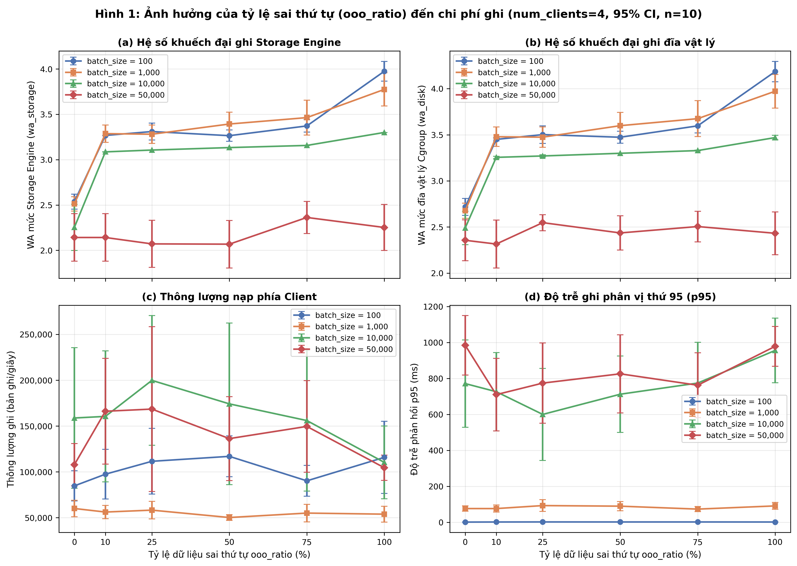
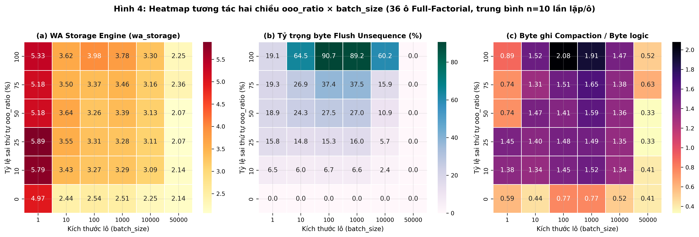
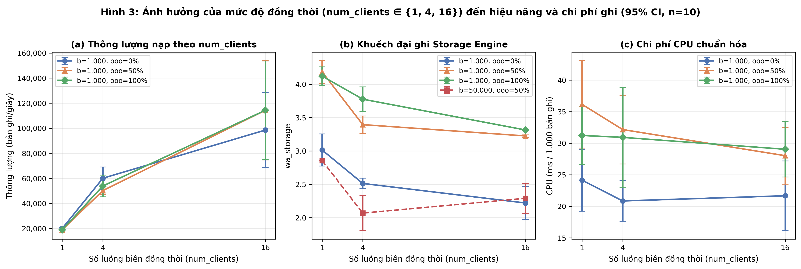
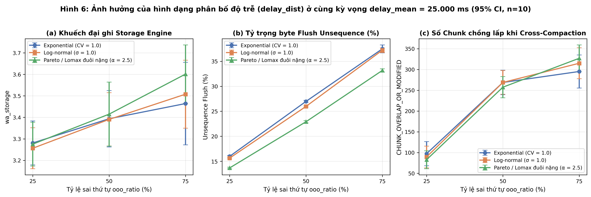
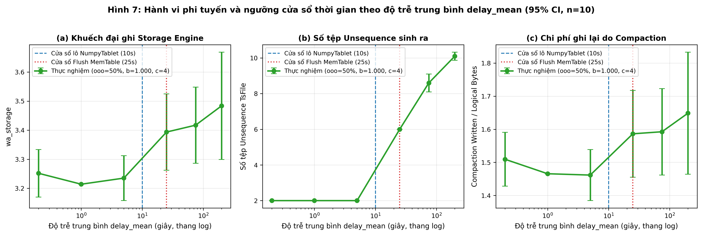
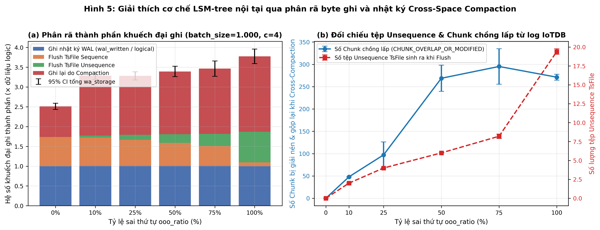

# BÁO CÁO NGHIÊN CỨU THỰC NGHIỆM

## Đo Lường Thực Nghiệm Ảnh Hưởng Của Thứ Tự Và Kích Thước Dữ Liệu Đến Chi Phí Ghi Vào Apache IoTDB

**Phiên bản hệ thống đánh giá:** Apache IoTDB `1.3.3-standalone` (`apache-iotdb==1.3.3`, Python `3.12.5`)  
**Quy mô tập dữ liệu thực nghiệm:** 698 lần chạy độc lập (28 lần chạy Pilot + 670 lần chạy Ma trận chính thức = 67 tổ hợp × 10 hạt giống độc lập)

---

## Tóm Tắt (Abstract)

Trong các hệ thống thu thập dữ liệu công nghiệp (IIoT), hiện tượng mất kết nối tạm thời giữa cổng biên (edge gateway) và máy chủ trung tâm khiến dữ liệu tồn đọng được đẩy về theo từng đợt dồn dập (burst) và lệch thứ tự thời gian phát sinh (out-of-order — OOO). Nghiên cứu này xây dựng bộ công cụ sinh tải xác định theo hạt giống (`seed`) và hệ thống đo lường đa tầng (Prometheus Exporter, Linux Cgroup v2 và phân tích nhật ký DataNode) để định lượng chi phí ghi thực tế trên **Apache IoTDB 1.3.3**. Trên tập dữ liệu chuẩn hóa gồm **670 lần chạy chính thức** (67 tổ hợp tham số × 10 lần lặp ngẫu nhiên hóa thứ tự thực thi), kết quả thực nghiệm cho thấy:

1. **Bước nhảy phi tuyến và độ lõm theo tỷ lệ sai thứ tự (`ooo_ratio`):** Tại `batch_size = 1.000, num_clients = 4`, chỉ cần `ooo_ratio` tăng từ `0%` lên `10%`, hệ số khuếch đại ghi mức Storage Engine (`wa_storage`) nhảy vọt **+30,8%** từ **2,51 ± 0,08** (95% CI: `[2,43; 2,59]`) lên **3,29 ± 0,10** (`[3,19; 3,38]`), và khuếch đại ghi đĩa vật lý (`wa_disk`) tăng **+30,0%** từ **2,68 ± 0,08** lên **3,48 ± 0,11** do các tệp `unsequence` có khoảng thời gian bao trùm rộng kích hoạt `CrossSpaceCompaction` ghi đè lại các chunk `sequence`. Trên miền `ooo_ratio > 0%`, hồi quy $\log_2-\log_2$ cho thấy mỗi khi `ooo_ratio` tăng gấp đôi ($\times 2$), tổng `wa_storage` tăng **1,035 lần** (95% CI: `[1,019; 1,051]`, $p = 4,37 \times 10^{-5}$) và phần chi phí khuếch đại vượt trội so với luồng tuần tự (`excess_wa`) tăng **1,129 lần** (95% CI: `[1,069; 1,192]`), đạt **3,78 ± 0,18** (+50,3%) tại `ooo_ratio = 100%`. Trong khi thông lượng pha nạp phía client không đổi có ý nghĩa thống kê ($p = 0,131$) nhờ kiến trúc ghi bất đồng bộ vào MemTable, thông lượng hiệu dụng toàn trình (tính cả thời gian dọn dẹp nền) sụt giảm tới **-38,9%** (từ **12.923 ± 1.161** xuống **7.900 ± 686 bản ghi/giây** ở `ooo_ratio = 50%`).
2. **Tác động áp đảo của kích thước lô (`batch_size`) và tương tác `ooo_ratio × batch_size`:** Phân tích phương sai hai nhân tố (Two-Way ANOVA, $N = 360$) xác nhận `batch_size` giải thích **85,49%** tổng biến thiên của `wa_storage` ($F(5, 324) = 1662,09, p = 1,62 \times 10^{-228}$) và tồn tại tương tác rất mạnh `ooo_ratio × batch_size` ($F(25, 324) = 15,05, p = 1,47 \times 10^{-40}, \eta_p^2 = 53,7\%$). Ở `batch_size = 1`, chi phí đóng khung nhật ký WAL từng dòng đẩy `wa_storage` lên **4,97–5,89** và chi phí CPU tới **596–760 ms/1.000 bản ghi**. Trên toàn dải `batch_size` $\in [1, 50.000]$ (tại `ooo_ratio = 50%`), mỗi khi `batch_size` tăng gấp đôi ($\times 2$), thông lượng nạp tăng **1,236 lần** (95% CI: `[1,193; 1,280]`), chi phí CPU trên 1.000 bản ghi giảm còn **0,806 lần** (`[0,785; 0,827]`, tức giảm **-19,4%**) và `wa_storage` giảm còn **0,956 lần** (`[0,950; 0,963]`). Đặc biệt, khi kích thước lô của từng luồng bao trọn tập điểm cần gửi (`batch_size = 50.000` tại `num_clients = 4`, `25.000` bản ghi/luồng), cơ chế sắp xếp mảng nội bộ của `NumpyTablet` triệt tiêu hoàn toàn `unsequence` TsFile (`0%`) ngay cả ở `ooo_ratio = 100%`, kéo `wa_storage` về **2,07–2,36**.
3. **Ngưỡng cửa sổ thời gian theo `delay_mean` và tính bất biến theo `delay_dist`:** Chi phí ghi thể hiện bước chuyển pha phi tuyến rõ rệt quanh cửa sổ lô client ($W_{\text{batch}} = 10\text{ s}$) và cửa sổ Flush MemTable ($W_{\text{mem}} = 25\text{ s}$): khi `delay_mean` vượt từ `5.000 ms` lên `25.000 ms`, số lượng tệp `unsequence` tăng gấp **3 lần** (`2,0` $\to$ `6,0` tệp) và số chunk chồng lấp phải giải nén (`CHUNK_OVERLAP_OR_MODIFIED`) tăng vọt **5,6 lần** (`48,0` $\to$ `268,8` chunk; ANOVA $F(5, 54) = 4,83, p = 0,0010$). Ngược lại, ở cùng kỳ vọng `delay_mean = 25.000 ms`, sự khác biệt tổng `wa_storage` giữa ba phân bố `exponential`, `lognormal` và `pareto` không có ý nghĩa thống kê ($F(2, 81) = 0,658, p = 0,521$) do sự bù trừ giữa trung vị nhỏ hơn (tăng hấp thụ tại MemTable) và đuôi cực trị dài hơn (mở rộng miền chồng lấp chunk) của phân bố đuôi nặng Pareto.

---

## 1. Cơ Sở Lý Thuyết

### 1.1. Kiến trúc LSM-tree và Phân tách Không gian Sequence / Unsequence trong Apache IoTDB

Cây ghép cấu trúc nhật ký (Log-Structured Merge-tree — LSM-tree, O'Neil et al., 1996) tối ưu hóa thông lượng ghi bằng cách biến đổi các thao tác cập nhật ngẫu nhiên thành thao tác ghi tuần tự vào nhật ký tiền ghi (**Write-Ahead Log — WAL**) và cấu trúc bộ nhớ khả biến (**MemTable**), sau đó kết xuất bất đồng bộ xuống đĩa thành các tệp bất biến có thứ tự rồi hợp nhất định kỳ qua tiến trình **Compaction**.

Apache IoTDB (Wang et al., *PVLDB* 2020; tài liệu chính thức IoTDB 1.3.x) điều chỉnh mô hình LSM-tree chuyên biệt cho dữ liệu chuỗi thời gian thông qua định dạng tệp cột phân cấp **TsFile** (gồm các *Page* được mã hóa như `GORILLA` cho số thực dấu phẩy động, gom thành *Chunk* nén bằng `LZ4`, kèm phần mục lục thời gian `[startTime, endTime]` cho từng thiết bị và chuỗi đo ở cuối tệp). Khác với LSM-tree khóa-giá trị tổng quát, công cụ lưu trữ của DataNode trong IoTDB duy trì cho mỗi thiết bị một mốc dấu thời gian cực đại đã được ghi bền vững xuống không gian tuần tự, ký hiệu là `lastFlushedTime` (cài đặt trong lớp `TsFileProcessor` / `DataRegion` của mã nguồn Apache IoTDB):

1. **Đường ghi dữ liệu mới:** Khi một điểm dữ liệu $(d, t, \mathbf{v})$ của thiết bị $d$ đến DataNode, bản ghi trước hết được tuần tự hóa vào bộ đệm **WAL** (`wal_mode = ASYNC` mặc định trong `iotdb-system.properties`). Tiếp theo, `DataRegion` so sánh $t$ với `lastFlushedTime[d]`:
   - Nếu $t > \text{lastFlushedTime}[d]$: điểm dữ liệu được phân loại vào không gian **Sequence**, chèn vào `WorkingMemTable` tuần tự hiện hành và cập nhật mốc thời gian mới nhất của thiết bị.
   - Nếu $t \le \text{lastFlushedTime}[d]$: điểm dữ liệu vi phạm ranh giới thời gian của các tệp `sequence` đã đóng trước đó, nên bắt buộc phải định tuyến sang không gian **Unsequence** (`UnseqWorkingMemTable`) riêng biệt.
2. **Hấp thụ sai thứ tự cục bộ trong RAM (`TVList`):** Bên trong một `WorkingMemTable`, mỗi chuỗi đo lưu mảng cặp thời gian-giá trị dưới dạng `TVList` (Time-Value List). Khi `MemTable` đạt ngưỡng đóng (ví dụ vượt `avg_series_point_number_threshold` hoặc ngưỡng bộ nhớ), tiến trình **Flush** thực hiện sắp xếp tăng dần `TVList` ngay trong bộ nhớ trước khi mã hóa `GORILLA` và nén `LZ4` xuống tệp `.tsfile` (`TsFileProcessor:1588`). Hệ quả cơ học cốt lõi là: **nếu một điểm đến trễ nhưng mốc thời gian $t$ của nó vẫn lớn hơn `lastFlushedTime[d]` (tức độ trễ nhỏ hơn cửa sổ tồn tại của `WorkingMemTable` trong RAM), điểm đó được sửa thứ tự hoàn toàn miễn phí về mặt I/O đĩa và vẫn tạo ra tệp `sequence` chuẩn.**

### 1.2. Cơ chế Inner-Space Compaction, Cross-Space Compaction và Hệ số Khuếch đại Ghi

Sự xuất hiện của các tệp trong thư mục `data/datanode/data/unsequence/` phá vỡ tính chất không chồng lấp khoảng thời gian giữa các TsFile, làm suy giảm hiệu năng truy vấn đọc và buộc IoTDB thực thi hai nhóm tác vụ nén gộp nền (tài liệu chính thức *Maintenance Tools / Metric Tool & Compaction*, IoTDB 1.3.3):

- **Inner-Space Compaction (`Sequence` hoặc `Unsequence`):** Bộ chọn `SizeTieredCompactionSelector` gộp các tệp TsFile nhỏ liền kề trong cùng một không gian (khi số tệp đạt `inner_compaction_candidate_file_num` hoặc thỏa điều kiện gộp tệp nhỏ của bộ lập lịch) thành tệp cấp cao hơn mà không đổi không gian lưu trữ (`InnerSpaceCompactionTask`).
- **Cross-Space Compaction (`RewriteCrossSpaceCompactionSelector` / `CrossSpaceCompactionTask`):** Lựa chọn một hoặc nhiều tệp `unsequence` cùng toàn bộ các tệp `sequence` có khoảng thời gian thiết bị giao cắt với chúng. Tiến trình phải đọc lại các tệp nguồn từ đĩa (`data_read_total{type="cross_compaction"}`), giải nén các *Chunk* và *Page* bị chồng lấp (được ghi nhật ký chi tiết dưới chỉ số `CHUNK_OVERLAP_OR_MODIFIED` và `PAGE_OVERLAP_OR_MODIFIED` tại `CrossSpaceCompactionTask:248`), hợp nhất theo thứ tự thời gian, mã hóa lại thành tệp `sequence` mới (`data_written_total{type="cross_compaction"}`) rồi xóa các tệp nguồn cũ.

Do đó, tổng hệ số khuếch đại ghi ở tầng công cụ lưu trữ (`wa_storage`) được phân rã tường minh thành bốn thành phần vật lý trên mỗi byte dữ liệu logic $B_{\text{logical}}$:

$$\text{WA}_{\text{storage}} = \frac{B_{\text{WAL}} + B_{\text{flush, seq}} + B_{\text{flush, unseq}} + B_{\text{compaction, write}}}{B_{\text{logical}}}$$

### 1.3. Cơ chế Sắp xếp Lô Nội bộ của `NumpyTablet` ở Phía Client

Kiểm tra trực tiếp mã nguồn thư viện chính thức `apache-iotdb==1.3.3` tại tệp `iotdb/utils/NumpyTablet.py` (dòng 56–60) cho thấy hàm khởi tạo `NumpyTablet.__init__` luôn gọi `NumpyTablet.check_sorted(timestamps)`; nếu phát hiện bất kỳ cặp chỉ số nào giảm dần trong lô kích thước $B$, client tự động thực thi `index = timestamps.argsort()` và hoán vị đồng bộ toàn bộ các cột cảm biến trong RAM của máy gửi trước khi đóng gói khung Thrift `TSInsertTabletReq`. Ngoài ra, kiểm tra `iotdb/Session.py` (dòng 169–175) và `thrift/transport/TSocket.py` (dòng 138–149) cho thấy kết nối `TFramedTransport(TSocket)` mặc định không bật cờ `socket.TCP_NODELAY`. Hai chi tiết thực thi này tạo nên tương tác trực tiếp giữa `batch_size` với cả chi phí compaction trên máy chủ lẫn độ trễ truyền tải RPC trên đường mạng.

---

## 2. Thiết Kế Thí Nghiệm

### 2.1. Hạ tầng Thực nghiệm và Cấu hình Cố định

Toàn bộ hạ tầng được đóng gói trong `docker-compose.yml` với phiên bản image ghim cứng tuyệt đối (chi tiết đầy đủ tại `docs/environment.md`):

| Thành phần | Thông số cấu hình thực tế |
| :--- | :--- |
| **Máy chủ vật lý (Host)** | AMD Ryzen 5 5600H (6 nhân / 12 luồng @ 3,29 GHz), 13,86 GiB RAM, ổ cứng NVMe SSD (`HFM256GDJTNI-82A0A` / `SAMSUNG MZALQ256HBJD`), Windows 10/11 Build 26200 |
| **Môi trường nhân container** | Docker Engine `29.2.1`, WSL2 Linux `6.18.54.1-microsoft-standard-WSL2`, Cgroup v2, hệ tệp `ext4` trên Docker Named Volume (`iotdb_exp_data`, `iotdb_exp_logs`) |
| **Container `iotdb-service`** | `apache/iotdb:1.3.3-standalone`, giới hạn cứng `cpus: 4.0`, `mem_limit: 3072m` |
| **Bộ nhớ JVM IoTDB** | DataNode: `1536 MiB` On-Heap + `512 MiB` Direct/Off-Heap; ConfigNode: `384 MiB` On-Heap + `128 MiB` Direct |
| **Cấu hình MemTable & WAL** | `wal_mode=ASYNC`, `avg_series_point_number_threshold=2500`, `iotdb_af_proportion=0.4`, `flush_thread_count=4` |
| **Cấu hình Compaction** | Bật đủ `Seq/Unseq Inner` và `Cross` Compaction; `compaction_schedule_interval_in_ms=2000`, `min_cross_compaction_unseq_file_level=0`, `inner_compaction_candidate_file_num=10`, `sub_compaction_thread_count=4` |
| **Hệ thống quan sát** | Prometheus `v2.54.1` (scrape `5s`), Grafana `11.2.2` (provisioned dashboard), cAdvisor `v0.49.1` |

**Ràng buộc nhất quán:** Các tệp cấu hình trong `docker/iotdb/` được giữ bất biến tuyệt đối trong suốt 670 lần chạy của ma trận chính thức.

### 2.2. Mô hình Sinh tải Điều khiển 4 Nhóm Tham số (`loadgen/`)

Mỗi luồng biên $c \in \{0, \dots, C-1\}$ quản lý một thiết bị độc lập `root.bench.edge_{c}` gồm $M = 6$ cảm biến kiểu `DOUBLE` (`s0..s5`, mã hóa `GORILLA`, nén `LZ4`). Mỗi bản ghi logic có kích thước chuẩn **56 byte** (`8 B` timestamp `INT64` + `6 × 8 B` giá trị `DOUBLE`), lấy mẫu gốc đều đặn mỗi $\Delta t = 10\text{ ms}$. Bộ sinh tải sử dụng `numpy.random.PCG64` với `SeedSequence(seed, client_id, stream_id)` tách riêng 4 nhánh ngẫu nhiên độc lập để đảm bảo **tính bất biến tập dữ liệu logic** (cùng một `seed` luôn sinh ra đúng một tập cặp $(t_i, \mathbf{v}_i)$, chỉ khác thứ tự xuất hiện tại máy chủ):

1. **Tỷ lệ sai thứ tự (`ooo_ratio` $\in [0\%, 100\%]$):** Với $0 < p < 1$, chọn ngẫu nhiên không hoàn lại đúng $K = \text{round}(p \cdot N_c)$ bản ghi trong $\{0, \dots, N_c - 2\}$ để gán độ trễ mạng dương $D_i > 0$ và sắp xếp luồng đến theo thời điểm tới $A_i = t_i + D_i$; tại $p = 0\%$ giữ nguyên thứ tự gốc ($D_i = 0$); tại $p = 100\%$ áp dụng hoán vị ngẫu nhiên đồng đều Fisher–Yates trên toàn bộ $N_c$ bản ghi (xáo trộn hoàn toàn). Tỷ lệ vi phạm đơn điệu thực nghiệm `empirical_ooo_ratio` cũng được đo lại trực tiếp trên luồng sinh ra.
2. **Hình dạng và kỳ vọng phân bố độ trễ (`delay_dist`, `delay_mean_ms`):** Ba phân bố chuẩn hóa cùng kỳ vọng lý thuyết $\mathbb{E}[D] = \mu_D$:
   - `exponential`: $\text{Exp}(\text{scale} = \mu_D)$ (hệ số biến thiên $\text{CV} = 1,0$).
   - `lognormal`: $\text{LogNormal}(\mu_{\ln} = \ln(\mu_D) - \frac{1}{2}\sigma^2, \sigma = 1,0)$ ($\text{CV} = \sqrt{e - 1} \approx 1,31$).
   - `pareto` (đuôi nặng Lomax / Pareto loại II dịch gốc): $D = s \cdot (U^{-1/\alpha} - 1)$ với $\alpha = 2,5$ (có phương sai hữu hạn nhưng kurtosis vô hạn, $\text{CV} = \sqrt{\alpha / (\alpha - 2)} \approx 2,24$) và $s = \mu_D(\alpha - 1) = 1,5\mu_D$.
3. **Kích thước lô (`batch_size` $\in \{1, 10, 100, 1.000, 10.000, 50.000\}$):** `batch_size = 1` gọi `Session.insert_record`; `batch_size > 1` gọi `Session.insert_tablet(NumpyTablet)`.
4. **Mức độ đồng thời (`num_clients` $\in \{1, 4, 16\}$):** Các luồng đồng bộ thời điểm xuất phát qua `threading.Barrier`, mỗi luồng mở kết nối `Session` riêng.

**Quy trình làm sạch và ổn định giữa các lần chạy:** Trước mỗi ma trận có bước `run_warmup` làm nóng JVM JIT. Trước mỗi lần chạy: `DELETE DATABASE root.bench` $\to$ đợi số tệp `seq`/`unseq` và hàng đợi nền về `0` $\to$ tạo lại database và đăng ký trước $6 \times C$ chuỗi đo $\to$ gọi `sync` hệ tệp trong container và chụp snapshot đầu $\to$ chạy pha nạp dữ liệu $\to$ gọi `FLUSH root.bench` đồng bộ và chờ tối thiểu **4,3 giây** liên tục không phát sinh tác vụ nền mới (> 2 chu kỳ lập lịch compaction `2.000 ms`) $\to$ gọi `sync` hệ tệp, chụp snapshot cuối và trích xuất lát cắt nhật ký DataNode của riêng `run_id` đó.

### 2.3. Kết quả Thăm dò Pilot và Chốt Thiết kế Ma trận 670 Lần chạy

Đợt chạy **Pilot** (`data/processed/pilot_runs.csv`, 28 lần chạy trên 14 tổ hợp đại diện) cho thấy hai phát hiện định hình thiết kế ma trận:
- **Hiệu ứng ngưỡng điểm trên mỗi chuỗi ở `batch_size = 1`:** Ở `batch_size = 1`, thông lượng RPC đơn lẻ chỉ đạt ~`1.013 bản ghi/giây` (`num_clients = 1`) và ~`2.997 bản ghi/giây` (`num_clients = 4`). Nếu chạy đủ `100.000` bản ghi cho mọi ô `batch_size = 1` sẽ tốn ~`100 giây/lần chạy`, làm phình tổng thời gian ma trận không cần thiết; tuy nhiên nếu giảm quá thấp xuống `4.000` bản ghi ở `num_clients = 4` (`1.000` bản ghi/luồng $< 2.500$), MemTable không bao giờ tự động flush giữa chừng (`unseq_files = 0`). Do đó, đối với `batch_size = 1` (ở `c = 4, 16`) ta ấn định `total_records = 12.000` (`3.000` bản ghi/luồng $> 2.500$, thời gian nạp ~`3,6–4,0 giây`, kích hoạt flush `unseq` thật; riêng `c = 1` dùng `6.000` bản ghi = `6.000` bản ghi/luồng $> 2.500$), và với `batch_size = 10` ấn định `total_records = 25.000` (`6.250` bản ghi/luồng ở `c = 4`), đồng thời so sánh bằng các chỉ số chuẩn hóa theo khối lượng (`wa_storage`, `wa_disk`, `cpu_ms_per_1k_records`, `throughput_rps`, `lat_per_1k_rows_p50_ms`).
- **Tính cộng hưởng tại `total_records = 100.000` cho `batch_size >= 100`:** Khối lượng `100.000` bản ghi (`5.600.000` byte logic) là bội số nguyên của `2.500` ở cả `num_clients = 1` (`40×` ngưỡng MemTable) và `num_clients = 4` (`25.000` bản ghi/luồng = `10×` ngưỡng MemTable), đồng thời đạt `6.250` bản ghi/luồng (`2,5×` ngưỡng MemTable) ở `num_clients = 16`.

Từ đó, ma trận chính thức (`scripts/run_matrix.py --mode full`) gồm **67 tổ hợp duy nhất × 10 lần lặp (`seed` $\in \{101, 202, \dots, 1010\}$) = 670 lần chạy**, chia thành 4 khối trực giao và khử trùng lặp tại các ô giao nhau:
1. **Khối A — Ma trận chính 2 chiều Full-Factorial (`main_matrix`, 36 tổ hợp = 360 lần chạy):** Toàn bộ `6` mức `ooo_ratio` $\in \{0, 10, 25, 50, 75, 100\}\%$ $\times$ toàn bộ `6` mức `batch_size` $\in \{1, 10, 100, 1.000, 10.000, 50.000\}$ tại `num_clients = 4`, `delay_dist = "exponential"`, `delay_mean_ms = 25.000`.
2. **Khối B — Ma trận đồng thời 3 chiều Full-Factorial (`concurrency_study`, 20 tổ hợp bổ sung, hợp với Khối A thành lưới cân bằng 27 ô = 270 lần chạy + dải `b = 1`):** `ooo_ratio` $\in \{0, 50, 100\}\%$ $\times$ `batch_size` $\in \{100, 1.000, 50.000\}$ $\times$ `num_clients` $\in \{1, 4, 16\}$ (cố định `100.000` bản ghi) cộng thêm `batch_size = 1, ooo_ratio = 50%` trên `num_clients` $\in \{1, 4, 16\}$.
3. **Khối C — Thí nghiệm phụ phân bố độ trễ (`delay_dist_study`, 6 tổ hợp bổ sung, hợp thành lưới 3 × 3 = 90 lần chạy):** `delay_dist` $\in \{\text{exponential}, \text{lognormal}, \text{pareto}\}$ $\times$ `ooo_ratio` $\in \{25, 50, 75\}\%$ tại `batch_size = 1.000, num_clients = 4, delay_mean_ms = 25.000`.
4. **Khối D — Thí nghiệm phụ độ trễ trung bình (`delay_mean_study`, 5 tổ hợp bổ sung, hợp thành dải 6 mức = 60 lần chạy):** `delay_mean_ms` $\in \{200, 1.000, 5.000, 25.000, 75.000, 200.000\}\text{ ms}$ tại `ooo_ratio = 50%, batch_size = 1.000, num_clients = 4, delay_dist = "exponential"`.

Toàn bộ 670 lần chạy được trộn ngẫu nhiên thứ tự thực thi (`seed = 20261026`). Trong quá trình chạy thật, lần chạy thứ `623` gặp lỗi mạng tạm thời `TSocket read 0 bytes`, được ghi tự động vào `data/raw/failed_runs.jsonl` và khôi phục hoàn chỉnh lên **670/670 lần chạy** (`0` lỗi RPC) ngay khi chạy lại `make experiment` (tổng thời gian đo 121,7 phút).

---

## 3. Kết Quả Thực Nghiệm

*Phương pháp thống kê:* Mọi giá trị báo cáo dưới dạng $\bar{x} \pm \text{CI}_{95\%}$ sử dụng khoảng tin cậy 95% theo **phân phối Student-$t$** với $n = 10$ lần lặp ($df = 9, t_{0.975, 9} = 2,262$), đồng thời được đối chiếu với **Percentile Bootstrap** ($B = 4.000$ lần lấy mẫu lại) trong tập `data/processed/summary_by_cell.csv`.

### 3.1. Ảnh hưởng của Tỷ lệ Dữ liệu Sai thứ tự (`ooo_ratio`)

Bảng 1 trình bày chi tiết các chỉ số chi phí ghi tại cấu hình chuẩn `batch_size = 1.000, num_clients = 4` (`100.000` bản ghi = `5,60 MB` dữ liệu logic/lần chạy), đối chiếu cả khoảng tin cậy Student-$t$ và Bootstrap:

| `ooo_ratio` | `wa_storage` (Mean ± 95% CI $t$) | Bootstrap 95% CI (`wa_storage`) | `wa_disk` (Mean ± 95% CI $t$) | Tệp `unseq` Flush | Tỷ trọng byte `unseq` (%) | Chunk chồng lấp (`overlap`) | Thông lượng nạp (records/s) | Thông lượng hiệu dụng (records/s) |
| :---: | :---: | :---: | :---: | :---: | :---: | :---: | :---: | :---: |
| **0%** | **2,512 ± 0,078** | `[2,478; 2,582]` | **2,677 ± 0,083** | 0,0 | 0,00% | 0,0 | 60.031 ± 8.984 | **12.923 ± 1.161** |
| **10%** | **3,287 ± 0,096** | `[3,224; 3,381]` | **3,479 ± 0,105** | 2,0 | 6,64% | 48,0 | 56.165 ± 7.240 | **9.928 ± 433** |
| **25%** | **3,281 ± 0,102** | `[3,193; 3,370]` | **3,474 ± 0,111** | 4,0 | 15,99% | 97,2 | 58.243 ± 9.474 | **10.231 ± 744** |
| **50%** | **3,394 ± 0,131** | `[3,294; 3,506]` | **3,599 ± 0,143** | 6,0 | 26,97% | 268,8 | 50.195 ± 3.048 | **7.900 ± 686** |
| **75%** | **3,464 ± 0,192** | `[3,316; 3,631]` | **3,675 ± 0,195** | 8,2 | 37,49% | 295,2 | 55.028 ± 9.599 | **7.698 ± 1.060** |
| **100%** | **3,775 ± 0,183** | `[3,617; 3,914]` | **3,972 ± 0,182** | 19,4 | 89,18% | 271,2 | 53.851 ± 8.692 | **8.317 ± 1.275** |

Các kết quả định lượng nổi bật từ Bảng 1 và Hình 1:
- **Bước nhảy ngưỡng ngay tại `ooo_ratio = 10%` và dạng đường cong lõm:** Hồi quy tuyến tính OLS trên toàn dải `[0, 1]` cho độ dốc $\beta_1 = +0,892$ (`95% CI: [0,684; 1,100]`, $R^2 = 0,559, p = 6,95 \times 10^{-12}$). Tuy nhiên, mô hình bậc hai $\text{wa\_storage} = \beta_0 + \beta_1 p + \beta_2 p^2$ cải thiện độ phù hợp lên $R^2 = 0,599$ với hệ số bậc hai âm có ý nghĩa thống kê $\beta_2 = -0,889$ (`95% CI: [-1,629; -0,148]`, $p = 0,0196$), xác nhận tốc độ tăng chi phí lớn nhất xảy ra ngay khi chuyển từ `0%` (hoàn toàn tuần tự) sang `10%` (+30,8% ở `b = 1.000`, +28,8% ở `b = 100`, +36,9% ở `b = 10.000`).
- **Quy luật lũy thừa trên miền sai thứ tự (`ooo_ratio > 0%`):** Hồi quy $\log_2-\log_2$ cho `batch_size = 1.000` ($p \in [10\%, 100\%]$) thu được hệ số co giãn $\gamma = 0,0493$ (`95% CI: [0,0273; 0,0714]`, $p = 4,37 \times 10^{-5}$): **khi tỷ lệ dữ liệu sai thứ tự tăng gấp đôi ($\times 2$), tổng `wa_storage` nhân lên 1,035 lần (`95% CI: [1,019; 1,051]`), còn phần khuếch đại ghi tăng thêm so với mức cơ sở tuần tự (`excess_wa = wa_storage - 2,512`) nhân lên 1,129 lần (`95% CI: [1,069; 1,192]`)**.
- **Chi phí CPU và Bộ nhớ:** Tại `batch_size = 1.000, c = 4`, chi phí CPU của container tăng **+54,3%** từ **20,84 ± 3,15 ms/1k bản ghi** (`0%` OOO) lên **32,15 ± 5,45 ms/1k bản ghi** (`50%` OOO) và **34,47 ± 6,35 ms/1k bản ghi** (`75%` OOO), trong khi mức sử dụng Heap đỉnh của DataNode duy trì ổn định quanh `1.196–1.282 MiB` (nằm an toàn dưới ngưỡng cấp phát `1.536 MiB`).

### 3.2. Ảnh hưởng của Kích thước Lô (`batch_size`) và Tương tác Hai chiều `ooo_ratio × batch_size`

Bảng 2 tổng hợp hiệu năng và chi phí ghi qua 5 bậc độ lớn của `batch_size` tại mức sai thứ tự điển hình `ooo_ratio = 50%, num_clients = 4` (đối chiếu với mốc tuần tự `0%`):

| `batch_size` | Bản ghi / lần chạy | `wa_storage` (`ooo=0%`) | `wa_storage` (`ooo=50%`) | `wa_disk` (`ooo=50%`) | Thông lượng nạp (`ooo=50%`, rps) | Độ trễ `p50` chuẩn hóa (ms/1k rows) | CPU container (`ooo=50%`, ms/1k rows) |
| :---: | :---: | :---: | :---: | :---: | :---: | :---: | :---: |
| **1** | 12.000 | 4,972 ± 0,223 | **5,176 ± 0,001** | 6,187 ± 0,133 | 3.617 ± 250 | 805,90 ± 18,4 | 633,81 ± 15,8 |
| **10** | 25.000 | 2,444 ± 0,274 | **3,643 ± 0,004** | 4,228 ± 0,023 | 18.904 ± 4.081 | 95,03 ± 6,2 | 149,53 ± 18,6 |
| **100** | 100.000 | 2,537 ± 0,083 | **3,265 ± 0,063** | 3,473 ± 0,065 | 116.901 ± 22.258 | 11,12 ± 0,5 | 35,92 ± 6,3 |
| **1.000** | 100.000 | 2,512 ± 0,078 | **3,394 ± 0,131** | 3,599 ± 0,143 | 50.195 ± 3.048 | 44,35 ± 0,2 | 32,15 ± 5,5 |
| **10.000** | 100.000 | 2,254 ± 0,255 | **3,134 ± 0,000** | 3,299 ± 0,002 | **174.147 ± 88.165** | **2,45 ± 0,9** | 25,19 ± 5,2 |
| **50.000** | 100.000 | 2,142 ± 0,262 | **2,068 ± 0,262** | **2,436 ± 0,186** | 136.257 ± 45.698 | 16,39 ± 4,5 | **18,03 ± 5,7** |

![Hình 2: Ảnh hưởng của kích thước lô (batch_size ∈ [1, 50.000]) đến chi phí ghi (num_clients=4, 95% CI, n=10)](figures/fig2_cost_vs_batch_size.png)

Các quy luật định lượng rút ra từ Bảng 2, Hình 2 và Heatmap Hình 4:
- **Hệ số co giãn theo `batch_size` (thang $\log_2-\log_2$ tại `ooo_ratio = 50%`):** Mỗi khi `batch_size` tăng gấp đôi ($\times 2$):
  - **Thông lượng nạp (`throughput_rps`)** tăng **1,236 lần** (`95% CI: [1,193; 1,280]`, $\beta = +0,306, R^2 = 0,717, p = 1,54 \times 10^{-17}$), tăng tổng cộng **48,1 lần** khi chuyển từ ghi đơn lẻ `batch_size = 1` (`3.617 rps`) lên `batch_size = 10.000` (`174.147 rps`).
  - **Chi phí CPU chuẩn hóa (`cpu_ms_per_1k_records`)** giảm còn **0,806 lần** (`95% CI: [0,785; 0,827]`, $\beta = -0,312, R^2 = 0,830, p = 5,61 \times 10^{-24}$), tức giảm tới **35,2 lần** từ `633,8 ms/1k` (`b = 1`) xuống `18,0 ms/1k` (`b = 50.000`).
  - **Khuếch đại ghi `wa_storage`** giảm còn **0,956 lần** (`95% CI: [0,950; 0,963]`, $\beta = -0,0646, R^2 = 0,742, p = 1,00 \times 10^{-18}$).
- **Ngưỡng hấp thụ toàn phần tại `batch_size = 50.000` (Hình 4b & 4c):** Tại `num_clients = 4`, tổng `100.000` bản ghi được chia đều thành `25.000` bản ghi trên mỗi luồng biên. Khi `batch_size = 50.000` ($\ge 25.000$), toàn bộ chuỗi điểm của từng thiết bị nằm trọn trong một `NumpyTablet` duy nhất và được sắp xếp tăng dần hoàn toàn ở phía client trước khi gửi. Kết quả là trên cột `50000` của Hình 4b, **tỷ trọng byte Flush Unsequence bằng đúng `0,0%` ở tất cả các mức `ooo_ratio` từ `0%` đến `100%`**, xóa bỏ hoàn toàn phạt khuếch đại ghi do dữ liệu sai thứ tự (`wa_storage` ở `100%` OOO chỉ là `2,25 ± 0,25` thay vì `3,98 ± 0,11` như ở `batch_size = 100`).

### 3.3. Ảnh hưởng của Số Luồng Đồng thời (`num_clients`) và Kiểm định ANOVA Đa Nhân Tố

Trên lưới cân bằng 3 chiều (`ooo_ratio` $\in \{0, 50, 100\}\%$ $\times$ `batch_size` $\in \{100, 1.000, 50.000\}$ $\times$ `num_clients` $\in \{1, 4, 16\}$, cố định `100.000` bản ghi, $N = 270$), tăng mức độ đồng thời mang lại hai tác động rõ rệt (Hình 3):
1. **Tăng tốc thông lượng nạp:** Tại `batch_size = 1.000, ooo_ratio = 50%`, thông lượng tăng **2,66 lần** khi mở rộng từ `1` luồng (**18.865 ± 610 rps**) lên `4` luồng (**50.195 ± 3.048 rps**, tương ứng giới hạn `4 vCPU` của container), và đạt **114.323 ± 39.652 rps** (**6,06 lần**) ở `16` luồng nhờ che giấu độ trễ chờ khung gói tin trên từng kết nối TCP. Với ghi đơn lẻ `batch_size = 1`, thông lượng tăng **3,78 lần** từ `1.216 ± 58 rps` (`c = 1`) lên `4.595 ± 532 rps` (`c = 16`).
2. **Giảm số lần tự động Flush và tương tác với kích thước lô:** Khi tổng khối lượng logic `100.000` bản ghi được phân tán trên nhiều thiết bị hơn (`100.000` bản ghi/thiết bị ở `c = 1` $\to$ `25.000` ở `c = 4` $\to$ `6.250` ở `c = 16`), số điểm trung bình trên mỗi chuỗi trong MemTable tăng chậm hơn, làm giảm số chu kỳ tự động flush và giảm số tệp `unsequence` sinh ra (tại `b = 1.000, ooo = 50%`: từ **9,7 tệp** ở `c = 1` xuống **6,0 tệp** ở `c = 4` và **2,0 tệp** ở `c = 16`, kéo `wa_storage` giảm từ **4,18 ± 0,17** xuống **3,39 ± 0,13** và **3,22 ± 0,03**). Đặc biệt, đường nét đứt `b = 50.000, ooo = 50%` trên Hình 3b chứng minh trực tiếp tương tác `batch_size × num_clients`: ở `c = 1`, `100.000` bản ghi phải tách làm 2 lô `50.000` nên vẫn rò rỉ dữ liệu trễ qua ranh giới hai lô (`1,0` tệp `unseq`, `wa_storage = 2,855 ± 0,0002`), trong khi ở `c = 4` và `c = 16`, mỗi luồng chỉ gửi 1 lô nên `unseq = 0` và `wa_storage` giảm xuống `2,068–2,290`.

Bảng 3 tổng hợp kết quả kiểm định **ANOVA Type-II** cho cả ma trận chính 2 chiều ($N = 360$) và ma trận cân bằng 3 chiều ($N = 270$) trên chỉ số `wa_storage`:

| Mô hình ANOVA | Nguồn biến thiên (Factor / Interaction) | Tổng bình phương ($\text{SS}$) | Bậc tự do ($df$) | Thống kê $F$ | Giá trị $p$ ($p$-value) | Tỷ trọng $\eta^2$ (%) | Partial $\eta_p^2$ (%) |
| :--- | :--- | :---: | :---: | :---: | :---: | :---: | :---: |
| **2-Way ($N=360$)** | `ooo_ratio` | 28,933 | 5 | 142,13 | $1,83 \times 10^{-79}$ | 7,31% | 68,69% |
| **2-Way ($N=360$)** | `batch_size` | 338,346 | 5 | 1662,09 | $1,62 \times 10^{-228}$ | **85,49%** | **96,25%** |
| **2-Way ($N=360$)** | `ooo_ratio × batch_size` | 15,317 | 25 | 15,05 | $1,47 \times 10^{-40}$ | 3,87% | **53,73%** |
| **2-Way ($N=360$)** | Sai số ngẫu nhiên (Residual) | 13,191 | 324 | — | — | 3,33% | — |
| **3-Way ($N=270$)** | `ooo_ratio` | 41,453 | 2 | 304,45 | $6,44 \times 10^{-67}$ | 30,31% | 71,48% |
| **3-Way ($N=270$)** | `batch_size` (miền Tablet `100..50k`) | 46,048 | 2 | 338,19 | $6,11 \times 10^{-71}$ | 33,67% | 73,57% |
| **3-Way ($N=270$)** | `num_clients` | 13,481 | 2 | 99,01 | $3,54 \times 10^{-32}$ | 9,86% | 44,90% |
| **3-Way ($N=270$)** | `ooo_ratio × batch_size` | 10,119 | 4 | 37,16 | $3,08 \times 10^{-24}$ | 7,40% | 37,95% |
| **3-Way ($N=270$)** | `ooo_ratio × num_clients` | 2,951 | 4 | 10,84 | $4,23 \times 10^{-8}$ | 2,16% | 15,14% |
| **3-Way ($N=270$)** | `batch_size × num_clients` | 4,297 | 4 | 15,78 | $1,71 \times 10^{-11}$ | 3,14% | 20,62% |
| **3-Way ($N=270$)** | `ooo_ratio × batch_size × num_clients` | 1,872 | 8 | 3,44 | $9,08 \times 10^{-4}$ | 1,37% | 10,17% |
| **3-Way ($N=270$)** | Sai số ngẫu nhiên (Residual) | 16,543 | 243 | — | — | 12,10% | — |

### 3.4. Kết quả Thí nghiệm Phụ: Hình dạng Phân bố Độ trễ (`delay_dist`) và Ngưỡng Độ trễ Trung bình (`delay_mean`)

1. **Hình dạng phân bố độ trễ (`delay_dist`, Hình 6):** Ở cùng kỳ vọng `delay_mean = 25.000 ms` (`batch_size = 1.000, c = 4`), kiểm định Two-Way ANOVA ($N = 90$) cho thấy nhân tố `delay_dist` không làm thay đổi có ý nghĩa thống kê tổng hệ số khuếch đại ghi `wa_storage` ($F(2, 81) = 0,658, p = 0,521, \eta^2 = 1,19\%$). Tuy nhiên, số liệu nội tại trên Hình 6b và 6c bộc lộ hai hiệu ứng đối nghịch thú vị của phân bố đuôi nặng `pareto` ($\alpha = 2,5$) so với `exponential`: tại `ooo_ratio = 75%`, `pareto` tạo ra **tỷ trọng byte Flush Unsequence thấp hơn** (`33,17%` so với `37,49%` của `exponential` và `37,22%` của `lognormal`), nhưng lại gây ra **số Chunk chồng lấp cao hơn** (`327,0` chunk so với `295,2` chunk của `exponential`) và trung bình mẫu `wa_storage` nhỉnh hơn nhẹ (`3,601 ± 0,136` so với `3,464 ± 0,192`).
2. **Ngưỡng phi tuyến theo độ trễ trung bình (`delay_mean_ms`, Hình 7):** Quét `delay_mean_ms` từ `200 ms` đến `200.000 ms` (`ooo_ratio = 50%, b = 1.000, c = 4`) cho thấy sự phụ thuộc có ý nghĩa thống kê cao ($F(5, 54) = 4,83, p = 0,0010, \eta^2 = 30,91\%$) với bước chuyển pha rõ rệt quanh hai ngưỡng vật lý:
   - **Miền dưới cửa sổ lô `NumpyTablet` ($\mu_D \in \{200, 1.000, 5.000\}\text{ ms} < W_{\text{batch}} = 10.000\text{ ms}$):** Hầu hết các điểm trễ được tái sắp xếp ngay trong lô client hoặc trong `WorkingMemTable` hiện hành; số tệp `unsequence` giữ phẳng tuyệt đối ở **2,0 tệp**, số chunk chồng lấp giữ phẳng ở **48,0–48,6 chunk**, và `wa_storage` đi ngang ở **3,214–3,252**.
   - **Miền vượt cửa sổ Flush MemTable ($\mu_D \ge W_{\text{mem}} = 25.000\text{ ms}$):** Ngay khi $\mu_D$ chạm `25.000 ms`, các bản ghi trễ rơi lùi về sau `lastFlushedTime` của các TsFile đã đóng; số tệp `unsequence` tăng gấp ba lên **6,0 tệp** (và tiếp tục lên **8,6 tệp** ở `75 s`, **10,1 tệp** ở `200 s`), số chunk chồng lấp nhảy vọt **5,6 lần** từ **48,0 lên 268,8 chunk** (`289,2` chunk ở `200 s`), đẩy `wa_storage` lên **3,394 ± 0,131** (và **3,484 ± 0,184** ở `200 s`).

---

## 4. Thảo Luận Cơ Chế Nội Tại LSM-tree / IoTDB

Đối chiếu trực tiếp các biến quan sát nội tại trên Hình 5 và nhật ký DataNode cho phép giải thích hoàn toàn các quy luật thực nghiệm mà không cần suy diễn ngoài dữ liệu:

1. **Bản chất của bước nhảy chi phí ở tỷ lệ sai thứ tự thấp (`0% -> 10%`) và sự suy giảm tỷ số nén TsFile:**
   Phân rã thành phần `wa_storage` tại `batch_size = 1.000, c = 4` (Hình 5a) cho thấy:
   - Chi phí ghi nhật ký **WAL** hầu như bất biến theo thứ tự dữ liệu (`1,003×` đến `1,006×` dung lượng logic cho mọi mức `ooo_ratio`), nhưng phụ thuộc cực mạnh vào `batch_size`: ở `batch_size = 1`, mỗi lệnh `insert_record` phải ghi lặp lại header đường dẫn thiết bị/chuỗi đo trong khung WAL khiến `wal_amp` vọt lên **3,644×** dữ liệu logic, giải thích trọn vẹn vì sao `batch_size = 1` có `wa_storage = 4,97` ngay cả khi dữ liệu đúng thứ tự 100%.
   - Tổng dung lượng tệp TsFile tạo ra ngay ở bước **Flush** (`seq_flush_amp + unseq_flush_amp`) phình to dần theo `ooo_ratio`: từ **0,736×** dung lượng logic ở `0%` OOO lên **0,802×** ở `50%` OOO (**+8,9%**) và **0,866×** ở `100%` OOO (**+17,6%**). Nguyên nhân trực tiếp ghi nhận trong nhật ký `TsFileProcessor:1588` là việc tách dữ liệu cùng một chuỗi đo sang cả tệp `sequence` lẫn `unsequence` làm nhân đôi cấu trúc siêu dữ liệu (`ChunkHeader`, `TimeseriesIndex`) và làm tăng phương sai bước nhảy thời gian/giá trị cục bộ, khiến tỷ số nén của bộ mã hóa vi sai `GORILLA` + `LZ4` giảm từ `~2,33` xuống `~2,00–2,04`.
   - Thành phần quyết định bước nhảy `+30,8%` của `wa_storage` tại `ooo_ratio = 10%` nằm ở **Compaction (`comp_write_amp`)**: ở `0%` OOO, chỉ có `InnerSpaceCompaction` gộp các tệp `sequence` nhỏ (`comp_write_amp = 0,773×`). Khi `ooo_ratio = 10%`, dù chỉ `5,1%` byte dữ liệu logic bị đẩy sang `2,0` tệp `unsequence`, khoảng thời gian `[startTime, endTime]` của hai tệp này trải dài trên nhiều chu kỳ MemTable, buộc `CrossSpaceCompactionTask` phải đọc và ghi lại toàn bộ các tệp `sequence` giao cắt (`48,0` chunk chồng lấp), làm `comp_write_amp` tăng gần gấp đôi lên **1,516×** (+96,1%). Khi `ooo_ratio` tiếp tục tăng từ `10%` lên `75%`, các điểm trễ mới chủ yếu rơi vào cùng các tệp `sequence` vốn đã bị chọn hợp nhất, nên `comp_write_amp` chỉ tăng nhẹ từ `1,516×` lên `1,648×` — tạo nên tính chất tăng lõm (concave saturation) đã kiểm chứng qua hệ số bậc hai âm $\beta_2 = -0,889$.

2. **Sự đánh đổi giữa Thông lượng Pha nạp (Foreground) và Nợ I/O Nền (Background Compaction Debt):**
   Kiểm định ANOVA trên thông lượng pha nạp `throughput_rps` cho thấy `ooo_ratio` không gây suy giảm có ý nghĩa thống kê ($F = 1,71, p = 0,131$ ở mô hình 2 chiều và $F = 0,91, p = 0,405$ ở mô hình 3 chiều). Điều này phản ánh đúng ưu điểm thiết kế của LSM-tree trong IoTDB: luồng xử lý RPC phía trước chỉ chèn điểm vào `TVList` trong RAM, còn việc giải nén và gộp chunk được đẩy sang nhóm luồng nền `IoTDB-Compaction-Worker`. Tuy nhiên, khi tính cả thời gian hệ thống phải xử lý hết hàng đợi Flush và Compaction nền (`effective_throughput_rps`), chi phí thực sự lộ diện rõ rệt: thông lượng hiệu dụng giảm **-23,2%** ngay tại `10%` OOO và giảm **-38,9%** tại `50%` OOO. Trong vận hành liên tục kéo dài, nếu tốc độ đẩy dữ liệu tồn đọng vượt quá thông lượng hiệu dụng này, hàng đợi `unsequence` sẽ tích tụ gây nghẽn bộ nhớ hoặc kích hoạt cơ chế hãm ghi (write throttling).

3. **Giải thích cơ chế bù trừ của phân bố đuôi nặng Pareto:**
   Với cùng kỳ vọng $\mu_D = 25\text{ s}$, trung vị (median) của phân bố `exponential` là $25 \ln 2 \approx 17,33\text{ s}$, trong khi trung vị của phân bố đuôi nặng `pareto`/Lomax ($\alpha = 2,5, s = 37,5\text{ s}$) chỉ là $37,5 \cdot (2^{1/2,5} - 1) \approx 11,98\text{ s}$ — gần sát cửa sổ sắp xếp `10 s` của `NumpyTablet`. Vì vậy, đa số các bản ghi bị trễ dưới phân bố `pareto` có độ trễ nhỏ và được hấp thụ ngay trong RAM, làm giảm tỷ trọng byte `unsequence` (`33,17%` so với `37,49%`). Đổi lại, một tỷ lệ nhỏ các điểm rơi vào phần đuôi cực nặng ($D \gg 100\text{ s}$) kéo giãn biên độ thời gian của tệp `unsequence` phủ lên nhiều tệp `sequence` lịch sử hơn (`327,0` chunk chồng lấp so với `295,2`). Hai cơ chế ngược chiều này triệt tiêu lẫn nhau về tổng byte ghi lại, giải thích trọn vẹn kết quả kiểm định $p = 0,521$.

4. **Hiện tượng nền độ trễ ~`44,4 ms`/RPC tại `batch_size = 1.000` (Hình 2c, 2d):**
   Dữ liệu thực nghiệm trên Bảng 2 ghi nhận `lat_p50_ms` ở `batch_size = 100` chỉ là `0,93–1,13 ms`/RPC, nhưng nhảy lên hằng số ~`44,4 ms`/RPC ở `batch_size = 1.000` trước khi được khấu hao mạnh ở `batch_size = 10.000` (`24,5–37,7 ms` cho `10.000` bản ghi, tức chỉ `2,45–3,77 ms/1k` bản ghi). Đối chiếu mã nguồn `iotdb/Session.py:169-175` và `thrift/transport/TSocket.py:138-149` xác nhận client Python mở socket TCP không bật `TCP_NODELAY`. Khi khung dữ liệu `TFramedTransport` của `1.000` bản ghi (~`56 KB`) vượt ngưỡng phân mảnh bộ đệm gửi trên đường chuyển tiếp cổng Windows–WSL2 Docker mà không có `TCP_NODELAY`, thuật toán Nagle tương tác với cơ chế **TCP Delayed ACK (~40 ms)** của nhân Linux gây ra đúng một chu kỳ trễ ~`40–44 ms` trên mỗi lệnh RPC. Phát hiện này cho thấy việc gom lô lên `10.000` bản ghi (hoặc bật `TCP_NODELAY` trong thư viện client) là tối quan trọng để tránh điểm trũng thông lượng ở cỡ lô trung bình ~`1.000` dòng.

---

## 5. Hạn Chế Của Nghiên Cứu

1. **Giới hạn tài nguyên phần cứng và môi trường ảo hóa:** Thí nghiệm được thực hiện trên cấu trúc single-node (`1 ConfigNode + 1 DataNode` trong container giới hạn `4 vCPU`, `3.072 MiB RAM`, DataNode `1.536 MiB` Heap) chạy trên nhân Linux WSL2 và ổ NVMe SSD cá nhân. **Mọi con số tuyệt đối về thông lượng, độ trễ và CPU chỉ có giá trị tham chiếu trong cấu hình phần cứng này**; trên cụm phân tán nhiều DataNode sử dụng giao thức đồng thuận `IoTConsensus` / `RatisConsensus` hoặc ổ cứng HDD cơ học, chi phí sao chép mạng và độ nhạy đối với I/O ngẫu nhiên của `CrossSpaceCompaction` sẽ lớn hơn đáng kể.
2. **Quy mô mỗi lần chạy và ngưỡng MemTable thu nhỏ có chủ đích:** Để hoàn tất 670 lần chạy độc lập có kiểm soát thống kê chặt chẽ, ngưỡng `avg_series_point_number_threshold` được cố định ở `2.500` điểm/chuỗi nhằm tái hiện đầy đủ nhiều chu kỳ Flush và Cross-Space Compaction trong phạm vi `100.000` bản ghi/lần chạy (`5,6 MB` logic). Trong các hệ thống sản xuất giữ ngưỡng mặc định lớn hơn (`10.000–100.000` điểm/chuỗi) với hàng trăm triệu bản ghi tích lũy qua nhiều tầng (multi-level TsFiles), cửa sổ hấp thụ trong RAM sẽ rộng hơn tương ứng nhưng chi phí gộp xuyên nhiều tầng `sequence` già (higher compaction levels) có thể tạo hệ số khuếch đại ghi cao hơn.
3. **Chưa kết hợp tải truy vấn đọc đồng thời (Mixed Read/Write Workload):** Nghiên cứu tập trung cô lập hoàn toàn chi phí ghi; ảnh hưởng của các tệp `unsequence` chưa kịp gộp lên độ trễ truy vấn đọc (`SeriesScanOperator` phải trộn nhiều con trỏ đọc) chưa được đo đồng thời trong ma trận này.

---

## 6. Kết Luận Và Khuyến Nghị Kỹ Thuật

Nghiên cứu đã xây dựng bộ công cụ thực nghiệm tự động, có khả năng tái lập chính xác theo hạt giống và định lượng thành công tác động của thứ tự đến cũng như kích thước lô dữ liệu lên chi phí ghi của **Apache IoTDB 1.3.3**:

- **Ảnh hưởng của `ooo_ratio`:** Sự xuất hiện của dữ liệu sai thứ tự gây ra bước nhảy chi phí phi tuyến ngay ở tỷ lệ nhỏ (`10%` OOO làm tăng **+30,8%** `wa_storage` và **+30,0%** byte ghi đĩa vật lý) do kích hoạt `CrossSpaceCompaction` trên các khoảng thời gian chồng lấp; ở mức xáo trộn hoàn toàn (`100%` OOO), `wa_storage` tăng **+50,3%** (từ `2,51` lên `3,78`) và thông lượng hiệu dụng toàn trình giảm tới **-38,9%**.
- **Ảnh hưởng của `batch_size`:** Là nhân tố chi phối mạnh nhất (**85,5%** phương sai `wa_storage` và **94,4%** phương sai $\log_{10}(\text{thông lượng})$). Tránh tuyệt đối việc gửi từng bản ghi đơn lẻ (`batch_size = 1`) khi xả dữ liệu tồn đọng sau mất kết nối vì chi phí WAL header làm `wa_storage` vọt lên **5,18–5,89** và tiêu tốn CPU gấp **~35 lần** so với gửi theo `NumpyTablet` lớn.
- **Khuyến nghị thiết kế tại máy chủ biên (Edge Gateway):** Trước khi đẩy dữ liệu tồn đọng sau sự cố mất mạng về IoTDB, cổng biên nên gom dữ liệu vào các lô `NumpyTablet` có kích thước từ **`10.000` đến `50.000` bản ghi** (hoặc đảm bảo bề rộng thời gian của lô $B \cdot \Delta t$ lớn hơn độ trễ mất kết nối trung bình $\mu_D$). Nhờ cơ chế tự sắp xếp trong bộ nhớ của `NumpyTablet` kết hợp với cửa sổ hấp thụ `TVList` của `MemTable`, giải pháp này giúp triệt tiêu phần lớn hoặc toàn bộ tệp `unsequence`, giảm hệ số khuếch đại ghi về sát mức tuần tự lý tưởng (`~2,1–2,5×`) đồng thời đạt thông lượng nạp trên `130.000–170.000 bản ghi/giây`.

---

## 7. Tài Liệu Tham Khảo

1. **Wang, C., Huang, X., Qiao, J., Jiang, T., Rui, L., Zhang, J., Kang, R., Feinauer, J., McGrail, K., Wang, P., Luo, D., Yuan, J., Wang, J., & Sun, J. (2020).** *Apache IoTDB: Time-series database for Internet of Things.* Proceedings of the VLDB Endowment (PVLDB), 13(12), 2901–2904.
2. **O'Neil, P., Cheng, E., Gawlick, D., & O'Neil, E. (1996).** *The log-structured merge-tree (LSM-tree).* Acta Informatica, 33(4), 351–385.
3. **Apache Software Foundation (2024).** *Apache IoTDB v1.3.3 Official Documentation — Storage Engine, TsFile Format, Compaction, and Metric Tool (Prometheus).* Truy cập tại: `https://iotdb.apache.org/UserGuide/V1.3.x/`
4. **Apache IoTDB v1.3.3 Source Code & Official Python Client (`apache-iotdb==1.3.3`).** Các mô-đun đối chiếu trực tiếp: `TsFileProcessor.java` (dòng 1588), `CrossSpaceCompactionTask.java` (dòng 248), `InnerSpaceCompactionTask.java` (dòng 261), `iotdb/utils/NumpyTablet.py` (dòng 56–60), `iotdb/Session.py` (dòng 169–175), và `thrift/transport/TSocket.py` (dòng 138–149).
